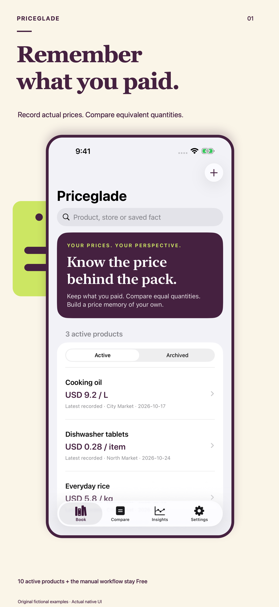
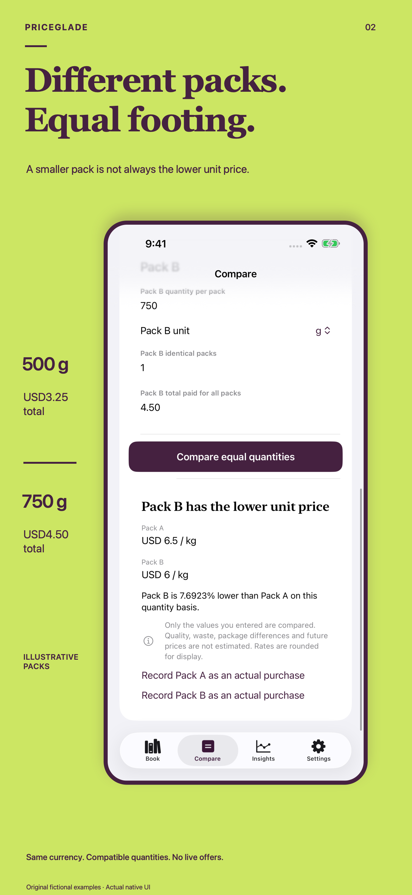
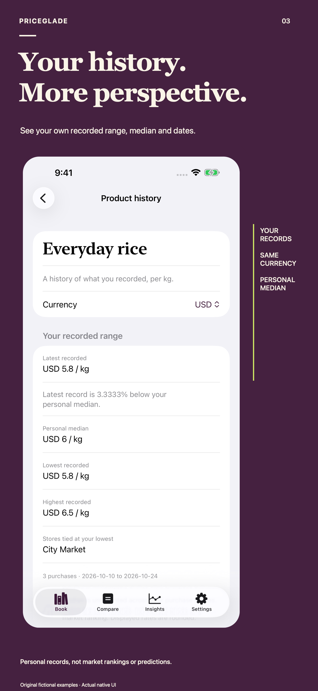

# Priceglade: Grocery Price Book

**Remember what you paid. Compare packs on one clear basis.**

[Product and guide](https://sepidehdalir.github.io/priceglade/) · [Privacy](https://sepidehdalir.github.io/priceglade/privacy.html) · [iOS portfolio](https://github.com/sepidehdalir/ios-app-portfolio)

**Production checkpoint — October 26, 2026. Version 1.0 (2) is uploaded. The app is not submitted, approved or released.** All 46 selected physical cases passed on the owned iPhone running iOS 27.2, and the exact archived Release is installed and open. Publisher hardware workflows, genuine Sandbox and Apple privacy/submission gates remain pending. TestFlight is skipped by publisher instruction.

## The job

Keep a personal record of actual purchases. Enter the product, store, date, currency, quantity per pack, identical-pack count and total paid for all packs. Compare compatible quantities and retrieve recorded latest, lowest, median and highest unit prices with dates and sample counts.

Three 500 g packs costing USD6 in total become 1.5 kg at USD4 per kg. The explicit pack basis prevents confusing a pack price with the total paid. Currencies stay separate. There is no live retailer feed, bank connection, market-lowest claim or exchange conversion.

## Product decisions

Free includes ten active products, reviewed manual entries, equivalent-quantity comparison, personal charts, stores and categories, corrections, Undo, archives, recoverable Trash and full JSON backup/recovery. Lifetime Pro adds more active products within device limits, new on-device text recognition, advanced filters and confirmed-purchase CSV. Apple supplies the localized one-time purchase price. Retained records and full recovery remain accessible if access changes.

Vision produces an unconfirmed text draft. Users select lines, correct fields and explicitly review before saving a purchase. Images are transient and are not retained with the book or backups. Recovery imports fresh archived copies while preserving current work and preferences.

## Engineering

Universal iPhone and iPad, deployment target 15.0 with SDK 26.5. SwiftUI, checked Foundation Decimal calculations, explicit metric/US/Imperial quantities, currency minor-unit rules, immutable historical snapshots and bounded graph validation. Coordinated atomic protected JSON writes publish changes only after persistence succeeds and reject stale revisions.

Vision runs on device; StoreKit 2 grants access from verified Apple transactions. Guarded URL links and exact Decimal display constants avoid forced unwraps in shipping code. No developer account, backend, advertising, tracking or analytics SDK.

## Dated verification

Build 2 passed 50 native iOS 17 cases covering calculation rules, real Vision recognition, persistence/recovery, model failures and local StoreKit states. Both selected screen checks passed: local Lifetime purchase/relaunch/completed Restore Purchases, and largest accessibility text with the paid amount visible above the keyboard. Current iPhone and iPad campaign flows also passed on build 2.

Earlier dated checks cover the reviewed manual workflow, ten-product limit followed by local Pro access, saved scan drafts, corrections/Undo/Trash/relaunch/archived restoration, narrow landscape, dark text, and native Files JSON/CSV save/open and backup import. Forty-six selected domain/native/model cases passed on the current iPad simulator before the final constants cleanup. These checkpoints retain their individual source and device scopes.

The signed build 2 archive and App Store export passed strict signature, identity, minimum-OS, Universal, privacy, resource and debug-hook audits. Apple confirmed upload succeeded, and build 2 is selected. All 46 selected domain, native I/O and model cases also passed on the owned iPhone with zero failures or skips; the exact archived Release was then installed and launched. Local StoreKit and automated physical evidence remain distinct from the pending publisher workflows and genuine Sandbox verification. Actual iOS 15 runtime and spoken VoiceOver remain unverified.

## Original campaign

The first three frames communicate the value, equivalent-quantity workflow and personal result. iPad has dedicated compositions. All screens are authentic native UI with original fictional examples. Recognition demonstration lines and confidence values do not establish OCR accuracy. Full-size exports and thumbnail sheets were inspected.

  

Commercial Swift source, tests, private QA artifacts and signing material remain private. No demand, revenue or search-ranking result is claimed.

Publisher: **Sepideh Javanbakht Dalir** · [arvinify.com](https://www.arvinify.com) · [hello@arvinify.com](mailto:hello@arvinify.com)
